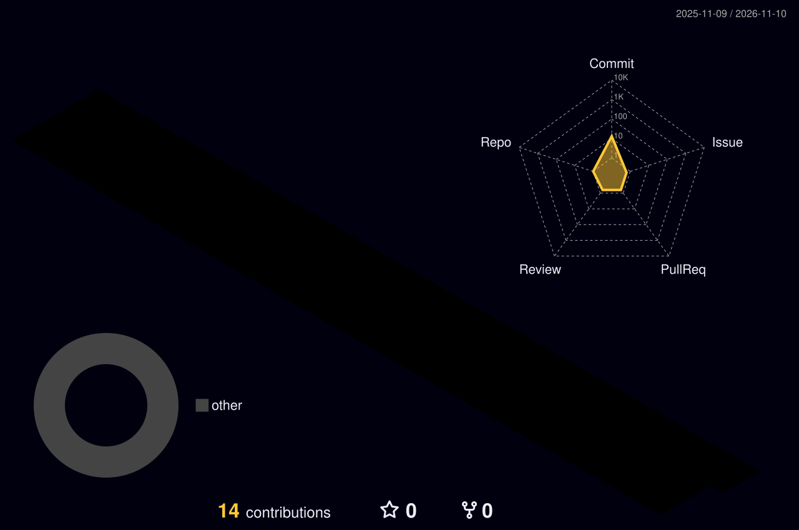

<!-- PREMIUM BURGUNDY HEADER -->

  

  <code>Cloud Engineering</code> •
  <code>DevOps</code> •
  <code>AI Solutions</code> •
  <code>GenAI</code> •
  <code>DevSecOps</code> •
  <code>Platform Engineering</code>

<h3 align="center">
  <em>Engineering intelligent infrastructure. Translating technology into business impact.</em>
</h3>

  
  
  

  

---

## About Me

I'm Komal Jaiswal, a DevOps Specialist at OpsTree Global, working at the intersection of **Cloud Infrastructure, DevOps Engineering, AI Solutions and Technical Communication.**

My work involves understanding complex engineering challenges, exploring technology solutions, translating technical capabilities into business value, and creating resources that help engineering teams and decision-makers understand emerging technologies.

I'm particularly interested in how Generative AI, LLMs and agentic workflows can transform traditional infrastructure and software delivery.

### What I Work On

- **Cloud Architecture:** AWS, Google Cloud Platform (GCP), infrastructure modernisation and cloud migration.
- **DevOps & Platform Engineering:** CI/CD, Kubernetes, Docker, Jenkins and infrastructure automation.
- **DevSecOps:** Pipeline security, vulnerability management and secure software delivery.
- **AI & GenAI:** LLMs, AI-driven engineering, agentic workflows and AI-powered automation.
- **Observability & AIOps:** Monitoring, incident management, logging and intelligent root-cause analysis.
- **Technical Solutions & GTM:** PRDs, solution documentation, technical proposals, whitepapers and enterprise case studies.

### Beyond Engineering

- DevOps and Generative AI trainer — 150+ students trained.
- Community speaker and technical knowledge-sharing enthusiast.
- Technical writer covering cloud, DevOps, AI and emerging technologies.
- Contributor to enterprise technical publications and solution narratives.

---

## Technology Stack

  

<b>Explore More Technologies & Tools</b>

**Cloud & Infrastructure**

AWS · GCP · Azure · Terraform · CloudFormation

**Containers & Orchestration**

Docker · Kubernetes · Helm · Docker Compose

**CI/CD & Automation**

Jenkins · GitHub Actions · GitLab CI/CD · Ansible

**Monitoring & Observability**

Prometheus · Grafana · ELK · OpenTelemetry · Datadog

**AI & Generative AI**

LLMs · Prompt Engineering · AI Agents · Agentic Workflows · Google Code Assist

**Databases & Tools**

Redis · ScyllaDB · TimescaleDB · Linux · Bash · Python

**Platform Engineering**

BuildPiper · KubeOps · DeployX · SecOps · REMS

---

## Hands-on Projects

A collection of technical experiments, infrastructure implementations and engineering projects.

| Project | Description | Repository |
|---|---|---|
| Redis Tool Evaluation | Exploring and evaluating Redis-related tools and capabilities | [View Project](https://github.com/komalthakur853/redis-tool-evaluation) |
| Docker Compose Redis | Redis deployment and containerisation using Docker Compose | [View Project](https://github.com/komalthakur853/dockercompose-redis) |

More projects coming: Cloud infrastructure, DevOps automation, AI solutions, LLM evaluation and agentic workflows.

---

## Enterprise Engineering Case Studies

Selected enterprise case studies published by OpsTree, covering real-world engineering challenges and measurable business outcomes.

These publications reflect my professional exposure and contributions to technical research, solution documentation, case-study development and enterprise technology communication.

| # | Case Study | Domain | Outcome |
|---|---|---|---|
| 01 | [AI-Driven Platform with TimescaleDB](https://opstree.com/case-study/how-an-ai-driven-platform-achieved-75-faster-query-performance-and-scalable-time-series-architecture-with-timescaledb/) | AI, Databases | 75% faster query performance |
| 02 | [AI-Driven Observability for Logistics](https://opstree.com/case-study/a-leading-logistics-platform-achieved-30-faster-incident-resolution-with-ai-driven-observability/) | AIOps, Observability | 30% faster incident resolution |
| 03 | [Sprinklr Multi-Cloud Modernisation](https://opstree.com/case-study/enterprise-scale-multi-cloud-infrastructure-modernization-with-zero-downtime-for-sprinklr/) | Multi-Cloud | Zero-downtime modernisation |
| 04 | [FinTech Infrastructure Automation](https://opstree.com/case-study/how-80-automation-enabled-a-2-person-team-to-run-enterprise-grade-fintech-infrastructure/) | Automation, FinTech | 80% automation |
| 05 | [AgriTech GCP-to-AWS Migration](https://opstree.com/case-study/agritech-platform-migrates-from-gcp-to-aws/) | Cloud Migration | Cloud platform migration |
| 06 | [Healthcare Monolith Decoupling](https://opstree.com/case-study/decoupling-a-monolith-to-power-scalable-healthcare-innovation/) | Application Modernisation | Scalable architecture |
| 07 | [AWS Cloud Cost Optimisation](https://opstree.com/case-study/nearly-40k-aws-cloud-cost-reduction-in-just-6-weeks/) | FinOps | Nearly $40K cost reduction |
| 08 | [CARS24 Platform Engineering](https://opstree.com/case-study/modernising-application-platform-engineering-for-cars24-with-aws-and-opstree/) | Platform Engineering | Application platform modernisation |
| 09 | [Enterprise Monitoring Transformation](https://opstree.com/case-study/transformed-monitoring-for-a-global-customer-communications-giant/) | Observability | Monitoring transformation |

---

## Whitepapers, Ebooks & Technical Publications

I work on translating complex technology concepts into structured, accessible technical resources for engineering teams, enterprise audiences and decision-makers.

**Areas of interest:**

- Artificial Intelligence and Generative AI
- Cloud Infrastructure and Architecture
- DevOps and DevSecOps
- Platform Engineering
- Observability and AIOps
- Application Modernisation
- Enterprise Technology Adoption

**[Explore OpsTree Whitepapers & Ebooks](https://opstree.com/ebooks/)**

---

## Technical Writing

I enjoy researching and writing about emerging technologies, infrastructure engineering and the evolution of software delivery.

**[Explore My Published Articles](https://opstree.com/blog/author/komaljaiswal/)**

Topics include:

- Kubernetes and containerisation
- Cloud engineering and infrastructure
- DevOps practices and automation
- AI-driven engineering solutions
- Cloud outages and reliability
- Observability and monitoring

---

## Teaching & Community

I believe engineering knowledge becomes more valuable when shared.

- Trained 150+ students in DevOps and Generative AI.
- Community speaker and technical knowledge-sharing contributor.
- Experience teaching Jenkins, Docker and Kubernetes.
- Interested in simplifying complex cloud and AI concepts for aspiring engineers.

---

## Currently Exploring

- Agentic AI and autonomous workflows
- LLM evaluation and AI model training
- AI-powered DevOps and infrastructure automation
- Cloud solution architecture
- AI-native platform engineering
- Product engineering and technical solution design

---

## GitHub Activity

  
  

  

---

## Contribution Universe

  

---

## Let's Connect & Collaborate

I'm interested in opportunities and collaborations across:

- AI Solutions and AI Engineering
- Cloud & DevOps Engineering
- Technical Solutions Architecture
- Developer Relations and Developer Advocacy
- Technical Product and Platform Engineering
- Freelance Technical Writing and Research

If you're building a product, exploring an engineering challenge or need help translating complex technology into meaningful content, let's talk.

  
  

  <i>Building at the intersection of Cloud, AI and Engineering.</i>

